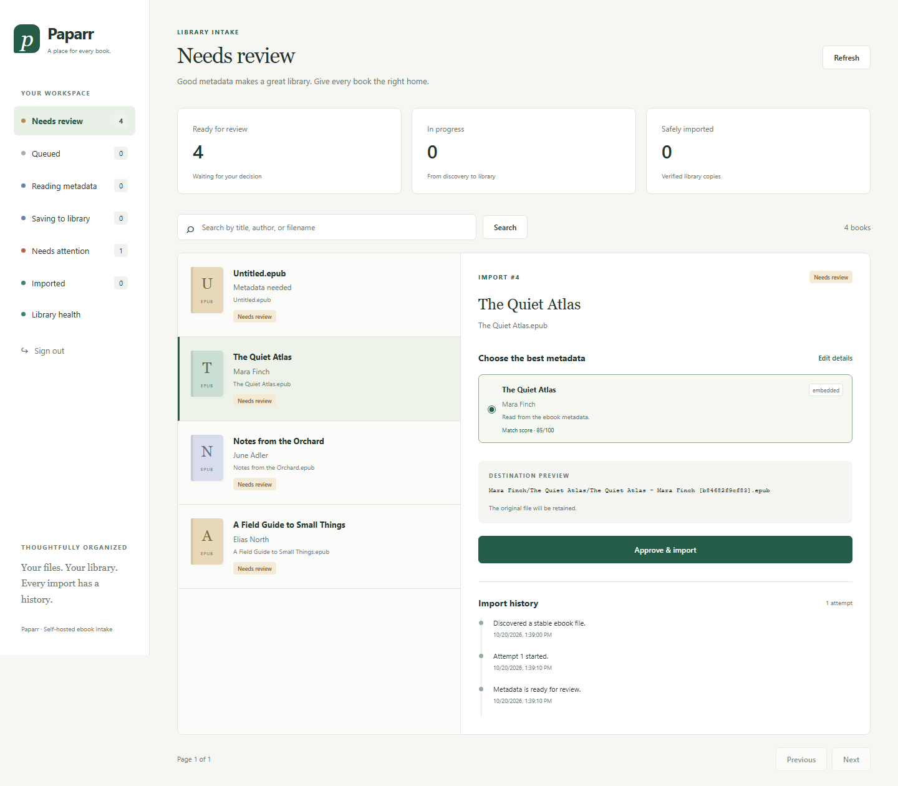

# Paparr

A self-hosted ebook intake workbench. Drop EPUB or PDF files into a watch folder, compare metadata choices, preview their destination, and approve them into an organized library.

Paparr keeps an import history and verifies file content before publication. Originals are retained by default. Interrupted publication can resume from persisted job state.



## What works

- Stable-file discovery and a durable PostgreSQL import queue.
- Duplicate-file history that explains skipped copies while leaving their files untouched.
- EPUB and PDF metadata extraction, with filename fallback.
- Open Library and Google Books candidates with source labels, matching evidence, caching, and rate-limit handling.
- Edition details with ISBN checksum checks, publisher, publication year, and language.
- A responsive review workspace with search, pagination, manual metadata, destination previews, and event history.
- Collision-safe publication, content verification, bounded attempts, retry, and recovery of interrupted jobs.
- Journaled temporary-file maintenance that preserves active attempts and files without confirmed ownership.
- Verified undo for imports whose original remains intact, with previews and recovery after interruption.
- Resumable integrity scans that identify missing, changed, and unreadable library files without modifying them.
- Worker status with stage progress, sanitized failures, and delay indicators.
- Owner-only library downloads with content verification and byte-range support.
- Calibre handoff archives with a verified book copy and approved metadata sidecar.
- Same-origin Docker deployment with persistent PostgreSQL storage.
- Owner sign-in with revocable sessions, CSRF protection, and sign-in rate limits.

All imports currently require review. Match scores describe title/author similarity; they are not probabilities. Paparr organizes files into its own library directory. Calibre exports provide an explicit handoff; Paparr does not write to a Calibre database.

## Run

Requires Docker Compose. Copy `.env.example` to `.env`, set `POSTGRES_PASSWORD`, and create the ingest and library directories. Build the API and generate an owner password hash:

```sh
docker compose build
docker compose run --rm --no-deps paparr-api --hash-password
```

Copy the resulting hash into `PAPARR_PASSWORD_HASH` in `.env`, then start Paparr:

```sh
docker compose up --build -d --wait
```

Open [localhost:5173](http://localhost:5173) and sign in. Add ebooks to the configured ingest folder. The default port binds to loopback; remote deployments also need HTTPS.

See the [deployment guide](DEPLOYMENT_GUIDE.md) for configuration, permissions, and synthetic demo files.

## Development

ASP.NET Core 10, PostgreSQL 18, React, and TypeScript.

```sh
dotnet tool restore
cd src/Paparr.UI
npm ci
npx playwright install chromium
cd ../..
pwsh scripts/verify.ps1
```

The suite includes unit tests with real ebook fixtures, PostgreSQL integration tests, React component tests, and desktop/mobile browser journeys. Integration tests use disposable infrastructure.

`pwsh scripts/Test-Deployment.ps1 -Browser` tests installation, publication, container recreation, integrity checks, backup restoration, and signed-in browser journeys in its own disposable Compose project. See the [verification record](docs/verification.md).

Read the [development guide](DEVELOPMENT_GUIDE.md), [architecture](docs/architecture.md), and [overhaul roadmap](docs/overhaul.md).

## Project status

Paparr is an early project undergoing an overhaul. Folder profiles and separate edition/file modeling remain planned work. See the [changelog](CHANGELOG.md) for the current release scope, [architecture](docs/architecture.md) for filesystem assumptions, and [benchmarks](docs/performance.md) for measured behavior.
