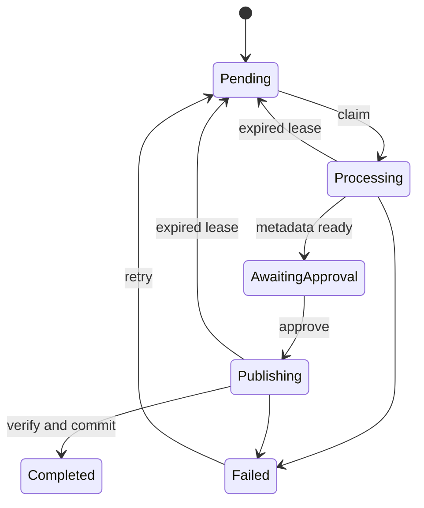

# Architecture

Paparr is a modular monolith: ASP.NET Core hosts the API and worker, PostgreSQL stores durable work, and React provides the review desk. The API and worker share the same application services.

## Import lifecycle

A unique SHA-256 index prevents duplicate content jobs. Revision tokens prevent two requests from claiming the same transition. Workers use leases to recover abandoned attempts; each claim is committed before its external effects begin. Failed publication retains the chosen metadata and destination so retry resumes the approved plan.

The scanner waits for unchanged length and modification time across observations before hashing a file. Duplicates remain in the ingest directory. Retries come from the persisted queue and do not depend on rediscovering a source.

Distinct paths with the same content hash become duplicate observations on the original import. A unique job/path-key constraint makes repeated and concurrent discovery idempotent without changing the job's revision or approval state. A scanner that loses a concurrent content insertion reloads the winning job and records its path immediately. Path keys use canonical absolute paths, with case folded on Windows.

The review desk fetches duplicate observations separately in bounded pages. These are historical observations, not an inventory of current files: removing or moving a duplicate does not erase its history. Only paths relative to the current ingest root are exposed; outside-root locations are hidden. Duplicate files are never scheduled for source cleanup.

A 512-entry discovery cache avoids hashing unchanged retained files on every poll. It revalidates after five minutes, invalidates changed size/timestamps, and drops paths no longer present. A same-size edit that preserves its timestamp can take up to five minutes to appear in discovery. Publication and cleanup still hash the actual bytes independently. Files that change while being hashed are deferred to a later scan.

## Publication protocol

1. Persist the selected candidate, destination, and publication lease.
2. Copy to a unique temporary file beside the destination.
3. Flush and verify the staged SHA-256 hash.
4. Rename without replacement. If the destination already exists, verify its hash.
5. Save the book, completed status, cleanup intent, and event in one database transaction.
6. If configured, verify both copies again before removing the source.

A crash between steps 4 and 5 leaves a published file that recovery can verify and reuse. A failed completion commit retains the source. Source cleanup has its own persisted attempts and lease; it can resume after a crash on either side of deletion. Three unsuccessful attempts retain the source and expose a retry action without failing the completed import. Disabling cleanup prevents further automatic removal. Old imports are not retroactively scheduled for deletion.

The filesystem and PostgreSQL do not share a transaction. This protocol makes interrupted work replayable, assuming the filesystem honors flush and rename semantics. It cannot guarantee durability after a storage-device failure. An abrupt process stop can leave an orphaned staging file; automatic staging cleanup is not implemented.

## Paths

Metadata becomes bounded portable path segments, truncated at UTF-8 character boundaries. Destination names contain a hash prefix to distinguish different content with identical metadata. Existing destinations are never overwritten with different bytes.

Operations check root containment and reject symbolic links/reparse points. Paparr should own its directories. These checks are not an OS sandbox against another local process replacing directory entries during an operation.

## Metadata

VersOne.Epub reads EPUB metadata; PdfPig reads PDF metadata. Filename fallback splits at the last spaced dash. Choices expose their origin and matching evidence. Similarity scores are not calibrated probabilities; every import requires approval.

Provider parsing skips malformed items independently. HTTP responses have a 2 MiB limit and a 10-second deadline covering headers and body. A shared gateway caches successful JSON for 15 minutes, with 128-entry and 16 MiB limits. Concurrent identical requests share a fetch; up to eight distinct fetches can run. Canceling a caller stops its wait while shared work remains bounded by its deadline.

Rate limits honor Retry-After up to five minutes. Transient failures impose a 30-second provider cooldown. Providers remain independent, and failures leave local metadata available. Cache and cooldown state are process-local.

## Library integrity

A scan snapshots the highest book ID and the corresponding count when queued. A filtered unique index permits one active scan. Each batch claims a lease, checks up to 20 files, and commits each result with its cursor. Recovery resumes after that cursor, so completed results are not counted twice.

Checks report verified, missing, changed, or unavailable files. They never repair, replace, or delete library files. Results describe bytes observed at the recorded time, not a guarantee that a file cannot change afterward. New imports are outside a running scan's snapshot.

## Deployment boundary

Worker diagnostics keep a process-local snapshot of queued work, cleanup, integrity, and discovery phases. Each phase records attempt, success, and failure times, a monotonic duration, and a curated error without paths or exception text. Delays measure elapsed time since progress; a delay is a signal to inspect ongoing work, not proof of deadlock. The owner-only endpoint disables response caching. Snapshots reset on restart and represent the serving instance, while PostgreSQL job and audit records remain the durable history.

Nginx serves the UI and proxies API requests on the same origin. The default Compose port binds to loopback, and neither PostgreSQL nor the API publishes a host port. Host filtering rejects unconfigured hostnames; unsafe browser requests from another origin are rejected. The proxy preserves the original Host and port.

Owner authentication protects API reads and writes by default. The password helper uses ASP.NET Identity's salted PBKDF2-HMAC-SHA512 hash with 210,000 iterations. Configuration contains the hash, not the password. Startup rejects missing or unsupported hashes while authentication is enabled.

ASP.NET cookie authentication protects a random session reference; PostgreSQL stores its ticket and eight-hour expiry. Sign-out deletes the row so a copied cookie cannot restore access. A claim derived from the configured password hash invalidates sessions after password rotation. Sliding renewal is disabled. The Data Protection key ring lives in a separate persistent volume; key loss invalidates sessions but leaves library records intact.

Every state-changing API request requires ASP.NET's antiforgery cookie/token pair, including sign-in and sign-out. The UI keeps the request token in memory and replaces it when the session changes. API authentication failures return HTTP errors, not HTML redirects. Five sign-in requests per minute per process bound password verification work; this limit resets on process restart.

HTTPS deployments require secure cookies and a trusted reverse proxy that forwards the public scheme. Only configured proxy networks and loopback can supply that scheme. With secure cookies enabled, API requests still observed as HTTP are rejected. Health probes remain available without sign-in. Remote TLS termination, multi-user accounts, and external identity providers are outside the current packaged setup.

These boundaries use the framework's [cookie authentication](https://learn.microsoft.com/en-us/aspnet/core/security/authentication/cookie?view=aspnetcore-10.0), [antiforgery](https://learn.microsoft.com/en-us/aspnet/core/security/anti-request-forgery?view=aspnetcore-10.0), and [forwarded headers](https://learn.microsoft.com/en-us/aspnet/core/host-and-deploy/proxy-load-balancer?view=aspnetcore-10.0) support.
