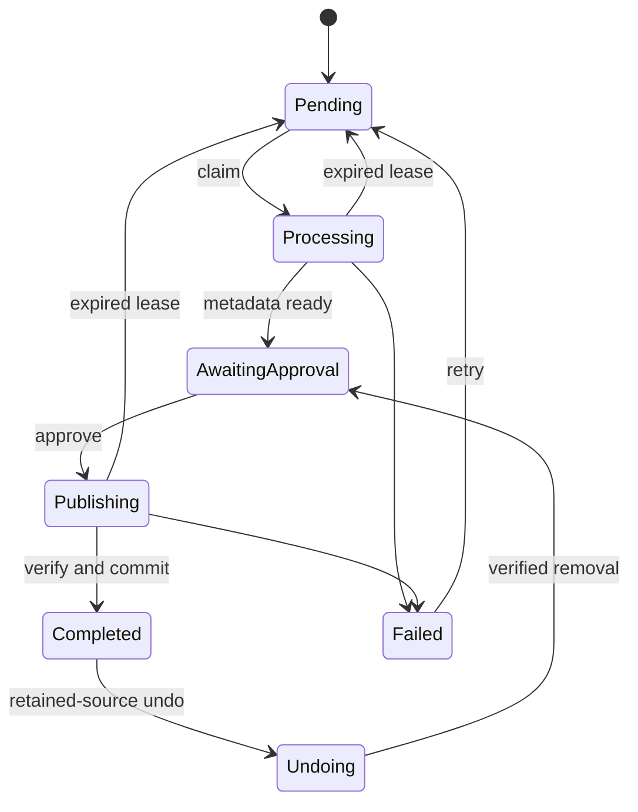

# Architecture

Paparr is a modular monolith: ASP.NET Core hosts the API and worker, PostgreSQL stores durable work, and React provides the review desk. The API and worker share the same application services.

## Import lifecycle

A unique SHA-256 index prevents duplicate content jobs. Revision tokens prevent two requests from claiming the same transition. Workers use leases to recover abandoned attempts; each claim is committed before its external effects begin. Failed publication retains the chosen metadata and destination so retry resumes the approved plan.

The scanner waits for unchanged length and modification time across observations before hashing a file. Duplicates remain in the ingest directory. Retries come from the persisted queue and do not depend on rediscovering a source.

Distinct paths with the same content hash become duplicate observations on the original import. A unique job/path-key constraint makes repeated and concurrent discovery idempotent without changing the job's revision or approval state. A scanner that loses a concurrent content insertion reloads the winning job and records its path immediately. Path keys use canonical absolute paths, with case folded on Windows.

The review desk fetches duplicate observations separately in bounded pages. These are historical observations, not an inventory of current files: removing or moving a duplicate does not erase its history. Only paths relative to the current ingest root are exposed; outside-root locations are hidden. Duplicate files are never scheduled for source cleanup.

A 512-entry discovery cache avoids hashing unchanged retained files on every poll. It revalidates after five minutes, invalidates changed size/timestamps, and drops paths no longer present. A same-size edit that preserves its timestamp can take up to five minutes to appear in discovery. Publication and cleanup still hash the actual bytes independently. Files that change while being hashed are deferred to a later scan.

## Publication protocol

1. Persist the selected candidate, destination, publication lease, and a new publication fence.
2. Journal the exact temporary path before creating it beside the destination. Confirm ownership in PostgreSQL while holding the exclusive creation handle, before copying any bytes.
3. Copy, flush, and verify the staged SHA-256 hash outside the publication transaction.
4. Lock the import row and check its fence and revision. Rename without replacement; if the destination already exists, verify its hash.
5. Save the book, completed status, cleanup intent, journal result, and event in that transaction.
6. If configured, verify both copies again before removing the source.

A crash between steps 4 and 5 leaves a published file that recovery can verify and reuse. A failed completion commit retains the source. Source cleanup has its own persisted attempts and lease; it can resume after a crash on either side of deletion. Three unsuccessful attempts retain the source and expose a retry action without failing the completed import. Disabling cleanup prevents further automatic removal. Old imports are not retroactively scheduled for deletion.

An expired publisher can finish copying after another worker recovers its job. Each new publication claim rotates the fence; the stale publisher must acquire the row lock and prove ownership before it can publish or record a failure. It cannot replace the recovered result.

File maintenance processes at most 20 due journal entries per cycle. It locks the parent import, excludes its current publication fence, and checks the exact recorded path, containment, and reparse points before deleting a confirmed temporary file. Already absent files settle without deletion. Permission and access failures leave bytes intact and retry with a delay of up to 60 minutes. Independent workers serialize maintenance through the same database lock.

A crash between exclusive file creation and the ownership commit leaves an uncertain file. If it is present, maintenance retains it for manual review and logs the import and stage IDs. Legacy and other untracked temporary files are never enumerated or deleted. The worker screen reports active, pending, retained, and settled attempts; settled counts include files already absent. These owner-only database counts are separate from process diagnostics, so a database outage does not prevent viewing the worker snapshot.

The filesystem and PostgreSQL do not share a transaction. This protocol makes interrupted work replayable, assuming the filesystem honors flush and rename semantics. It cannot guarantee durability after a storage-device failure.

## Retained-source undo

Undo returns a completed import to review while retaining its original file. A read-only preview verifies the recorded source and library copy, reports their relative paths, and captures the current import revision. Starting undo rechecks that decision under the import row lock. Missing, changed, oversized, unsafe, or unreadable copies prevent a new request; duplicate observations do not replace the recorded original.

Before deleting anything, Paparr saves an undo journal containing the operation ID, book ID, exact paths, and original hash, changes the import to `Undoing`, and disables its source cleanup. Execution locks the parent row, checks that snapshot and both files again, removes only the library file, and atomically removes the book record and returns the import to `AwaitingApproval`. Candidates, events, duplicate history, and the original content identity remain. Explicit approval republishes the file; the scanner cannot approve it automatically.

The operation ID stays bound to its original book. Repeating a completed request cannot undo a later reapproval. A failed completion commit after file deletion leaves durable undo intent; recovery verifies the retained original and can reconcile an already absent destination. Cancellation rolls back the current database transaction, leaving that intent available after restart. Access failures retry up to three times before requiring an explicit retry of the same operation. Pending and retained undo operations remain visible under **Returning to review**.

Source cleanup now locks the same parent row after its durable claim, checks its revision and current status again, and holds that lock through verification, deletion, and completion. An obsolete cleanup attempt cannot remove an original after undo wins ownership. If cleanup wins first and removes the original, undo is unavailable.

Audit and undo admission share a PostgreSQL transaction advisory lock. A new undo waits for any active integrity scan to finish; a new scan is rejected while an import is undoing. This keeps the scan's book count and cursor meaningful. Undo does not restore deleted originals, choose alternate duplicate sources, delete empty folders, or erase import history.

## Paths

Metadata becomes bounded portable path segments, truncated at UTF-8 character boundaries. Destination names contain a hash prefix to distinguish different content with identical metadata. Existing destinations are never overwritten with different bytes.

Operations check root containment and reject symbolic links/reparse points. Paparr should own its directories. These checks are not an OS sandbox against another local process replacing directory entries during an operation.

## Metadata

Folder profiles are startup configuration. Discovery selects the longest complete ingest-relative folder prefix and saves its name, source folder, optional collection, and filename order on the new import. The content-hash constraint means the first durable job owns this snapshot; duplicate observations cannot replace it. Legacy rows receive `TitleAuthor` with no profile or collection.

Collection names are exact portable path segments. Preview and approval share one destination helper, and execution rechecks the saved collection and destination against the configured library. Profile changes do not alter saved jobs; undo preserves the snapshot. Filename order affects only fallback parsing, while complete embedded metadata remains preferred. Windows matching ignores case; Linux matching is ordinal and case-sensitive.

VersOne.Epub reads EPUB metadata; PdfPig reads PDF metadata. Default filename fallback splits at the last spaced dash; author-first profiles use the first separator. Choices expose their origin and matching evidence. Similarity scores are not calibrated probabilities; every import requires approval.

Edition fields travel with each candidate and the approved book. ISBN-10 values convert to ISBN-13 only after checksum validation. Missing, invalid, and multiple distinct valid identifiers have different states; ambiguous identifiers are not reduced to a guessed ISBN. Publisher, year, and language are bounded optional values. Open Library search results summarize works and can span editions, so only individually unambiguous fields are shown and their evidence carries that caveat. [Open Library's search documentation](https://openlibrary.org/dev/docs/api/search) explains the work/edition distinction.

Manual title/author choices do not inherit another candidate's edition fields. Reviewers can explicitly enter optional edition details; the server derives ISBN status and rejects invalid field lengths and year bounds. A valid checksum does not establish that an ISBN belongs to the ebook's bytes. Existing records receive empty edition details through an additive migration.

Provider parsing skips malformed items independently. HTTP responses have a 2 MiB limit and a 10-second deadline covering headers and body. A shared gateway caches successful JSON for 15 minutes, with 128-entry and 16 MiB limits. Concurrent identical requests share a fetch; up to eight distinct fetches can run. Canceling a caller stops its wait while shared work remains bounded by its deadline.

Rate limits honor Retry-After up to five minutes. Transient failures impose a 30-second provider cooldown. Providers remain independent, and failures leave local metadata available. Cache and cooldown state are process-local.

## Library integrity

A scan snapshots the highest book ID and the corresponding count when queued. A filtered unique index permits one active scan. Each batch claims a lease, checks up to 20 files, and commits each result with its cursor. Recovery resumes after that cursor, so completed results are not counted twice.

Checks report verified, missing, changed, or unavailable files. They never repair, replace, or delete library files. Results describe bytes observed at the recorded time, not a guarantee that a file cannot change afterward. New imports are outside a running scan's snapshot.

## Library downloads

Downloads require owner access and a linked original hash. The service validates containment and file type, opens the library file once, checks its configured size limit, hashes that stream, and rewinds the same handle for ASP.NET's attachment and byte-range response. Failed verification returns a conflict without changing library bytes or integrity records. The response disables caching and derives a bounded portable filename from the approved metadata.

Verification and serving share one open handle to avoid reopening a replaced path. On Unix, another local process can still modify bytes in place while a response is sent; Paparr should own its library directory. The web client buffers the response so it can display download failures without leaving the library screen. Its memory use depends on file size; direct API clients can use byte ranges.

Calibre exports reuse that verified stream and copy its bytes into a private, non-cached ZIP with fixed entry names. An OPF sidecar records approved metadata, while a static README describes the client-side handoff. XML writing escapes metadata and removes characters XML cannot represent; title and author values beyond 64K characters return an actionable error. A year-only publication value stays year-only. No Calibre process runs on the server and no stored ebook or database record changes. Archives are buffered in memory and inherit the configured file-size limit.

## Deployment boundary

Worker diagnostics keep a process-local snapshot of queued work, cleanup, integrity, and discovery phases. Each phase records attempt, success, and failure times, a monotonic duration, and a curated error without paths or exception text. Delays measure elapsed time since progress; a delay is a signal to inspect ongoing work, not proof of deadlock. The owner-only endpoint disables response caching. Snapshots reset on restart and represent the serving instance, while PostgreSQL job and audit records remain the durable history.

Nginx serves the UI and proxies API requests on the same origin. The default Compose port binds to loopback, and neither PostgreSQL nor the API publishes a host port. Host filtering rejects unconfigured hostnames; unsafe browser requests from another origin are rejected. The proxy preserves the original Host and port.

Owner authentication protects API reads and writes by default. The password helper uses ASP.NET Identity's salted PBKDF2-HMAC-SHA512 hash with 210,000 iterations. Configuration contains the hash, not the password. Startup rejects missing or unsupported hashes while authentication is enabled.

ASP.NET cookie authentication protects a random session reference; PostgreSQL stores its ticket and eight-hour expiry. Sign-out deletes the row so a copied cookie cannot restore access. A claim derived from the configured password hash invalidates sessions after password rotation. Sliding renewal is disabled. The Data Protection key ring lives in a separate persistent volume; key loss invalidates sessions but leaves library records intact.

Every state-changing API request requires ASP.NET's antiforgery cookie/token pair, including sign-in and sign-out. The UI keeps the request token in memory and replaces it when the session changes. API authentication failures return HTTP errors, not HTML redirects. Five sign-in requests per minute per process bound password verification work; this limit resets on process restart.

HTTPS deployments require secure cookies and explicit trust at both proxy hops. Nginx accepts an incoming scheme only from its configured immediate TLS proxy, and the API separately trusts its immediate Nginx peer. Nginx validates the CIDR configuration before starting and runs without root. With secure cookies enabled, API requests still observed as HTTP are rejected. Health probes remain available without sign-in. Public certificate provisioning, multi-user accounts, and external identity providers are outside the packaged setup.

These boundaries use the framework's [cookie authentication](https://learn.microsoft.com/en-us/aspnet/core/security/authentication/cookie?view=aspnetcore-10.0), [antiforgery](https://learn.microsoft.com/en-us/aspnet/core/security/anti-request-forgery?view=aspnetcore-10.0), and [forwarded headers](https://learn.microsoft.com/en-us/aspnet/core/host-and-deploy/proxy-load-balancer?view=aspnetcore-10.0) support.
